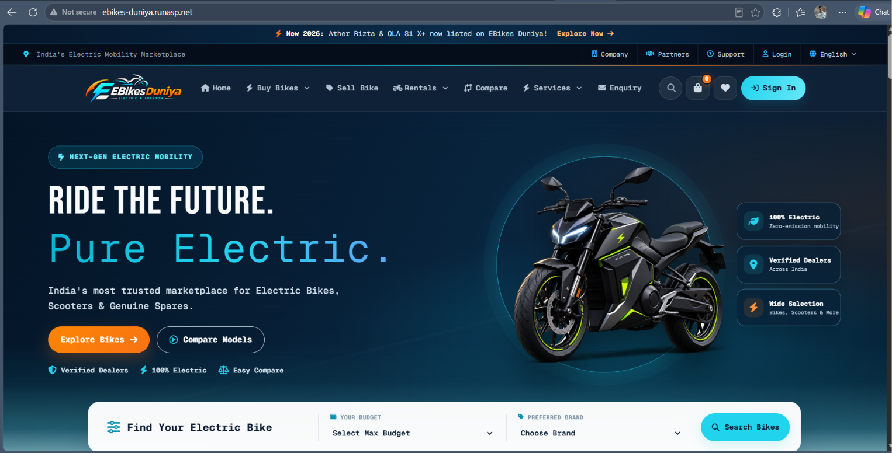
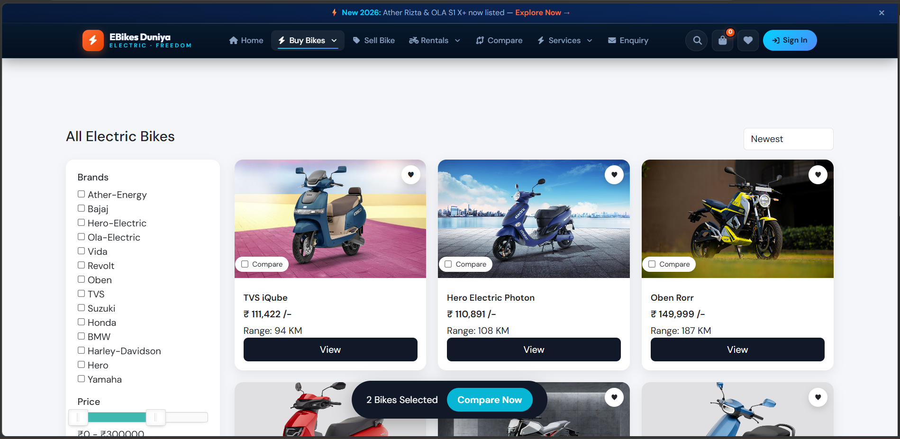
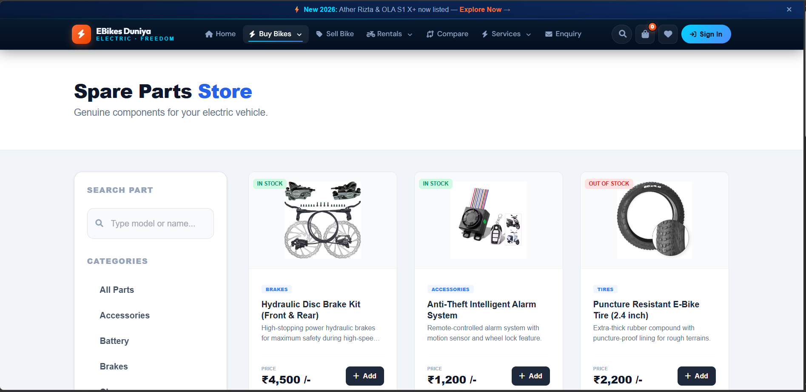
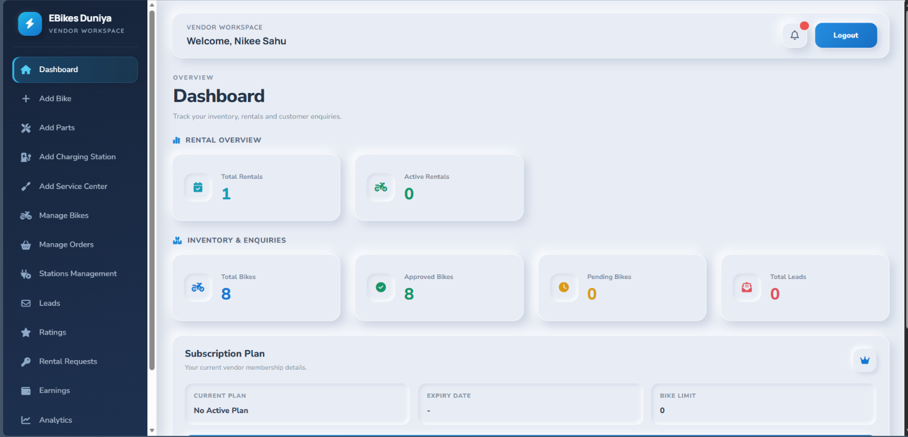
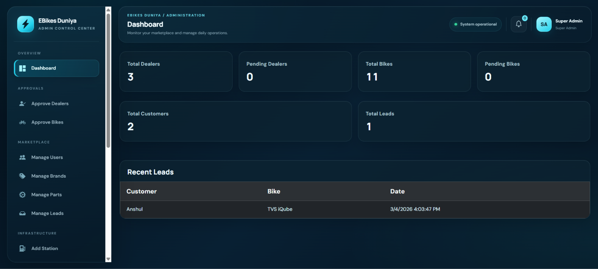

<div align="center">

# ⚡ EBikes Duniya

### A marketplace for electric bikes, parts, rentals, and more

[](http://ebikes-duniya.runasp.net/)

[**http://ebikes-duniya.runasp.net/**](http://ebikes-duniya.runasp.net/)

Built with ASP.NET Web Forms, C#, and SQL Server


</div>

---

## Overview

EBikes Duniya is a multi-vendor electric mobility marketplace. Customers can discover and compare electric bikes, contact vendors, browse parts, and explore rental and used-bike listings. Vendors manage listings and customer activity through a dedicated portal, while administrators manage marketplace content and operations.

## Key features

### Customer experience

- Browse, search, and filter electric bikes; view specifications and reviews
- Compare bikes and save favorites to a wishlist
- Submit bike enquiries and review enquiry history
- Browse parts, use the cart and checkout flow, and view order details
- Explore rental bikes, manage rental bookings, and browse used-bike listings
- Find charging stations and service centers
- Register and sign in, verify accounts with OTP, and reset passwords

### Vendor portal

- Register and manage a vendor profile
- Add and manage bike listings, parts, charging stations, and service centers
- Track customer leads, orders, and rental requests
- View vendor analytics, earnings, and subscription information

### Administration

- Manage users, brands, leads, and site settings
- Review vendor and bike approvals
- Manage parts, charging stations, and service centers
- Oversee rentals, settlements, subscription requests, and reports

## Technology stack

- **Application:** ASP.NET Web Forms, C#, .NET Framework 4.5
- **Data access:** ADO.NET (`System.Data.SqlClient`)
- **Database:** Microsoft SQL Server / LocalDB
- **UI:** HTML, CSS, JavaScript, jQuery, Bootstrap 5
- **Web server:** IIS (or IIS Express for local development)

The pages also load UI libraries and assets from CDNs, including Font Awesome.

## Getting started

### Requirements

- Windows with Visual Studio and the .NET Framework 4.5 targeting/runtime components
- SQL Server or SQL Server LocalDB
- IIS or IIS Express

### Setup

1. Clone or download this repository.
2. Create a database named `EBIke` (or choose another name and use it consistently).
3. In SQL Server Management Studio, run **one** schema script against that database: `tables.sql` or `EBikesDuniya_Production.sql`. These scripts define the database tables; do not run both against the same empty database.
4. Open `Web.config` and update the `Electronic` connection string for your SQL Server instance and database. Keep any credentials local and out of source control.
5. In Visual Studio, use **File → Open → Web Site** and select the repository folder. Run the site with IIS Express, or configure the folder as an IIS application.
6. Open the local URL provided by IIS Express or IIS.

## Project structure

```text
.
├── Admin/                    # Administration pages
├── Client/                   # Customer-facing pages
├── Vendor/                   # Vendor portal pages
├── Uploads/                  # Uploaded and project images
├── New folder/               # Bike image assets
├── Web.config                # ASP.NET and database configuration
├── tables.sql                # Database schema
├── EBikesDuniya_Production.sql
└── SQLQuery1.sql             # Additional database script
```

## Screenshots

### Homepage



### Bike details



### Spare parts



### Vendor dashboard



### Admin dashboard



## Developer

**Rajesh Sahu** — ASP.NET developer

---

Made with ❤️ by Rajesh Sahu
